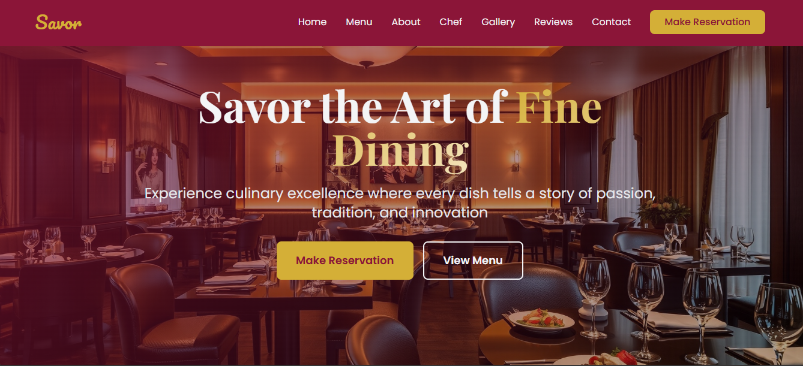

  <!-- Dynamic Animated Header Banner -->
  

  <!-- Animated Typing SVG Subtitle -->
  

    

  <!-- Social & Quick Action Badges -->
  

    
    
    
    
  

---

### 👨‍💻 Executive Summary

> *"Engineering high-concurrency SaaS solutions, bulletproof offline-first architectures, and frictionless user experiences that empower businesses to scale."*

I am **Ronit Goswami**, a full-stack engineer and software architect specializing in **cloud SaaS architectures**, **multi-tenant ERP/POS systems**, and **hardware-to-software integrations**. My work bridges robust backend engines (Laravel, PHP 8.3+, MySQL, Redis) with ultra-responsive frontend frameworks (Alpine.js, Tailwind CSS, Vue.js) and hardware protocols (ESC/POS thermal printing over USB, Bluetooth BLE, and TCP/IP LAN).

- 🔭 **Current Focus**: Architecting and maintaining **RestoPulse Cloud POS** — an enterprise-grade hospitality operating system with offline-first state synchronization, kitchen display systems (KDS), and automated billing.
- ⚡ **Core Philosophy**: Zero-downtime reliability, rigorous verification testing, strict monetary integer arithmetic (paise precision), and clean, self-documenting code.
- 🌱 **Continuous Learning**: Advanced distributed systems, real-time WebSockets, microservices scalability, and cloud infrastructure orchestration.

---

### 🛠️ Technical Arsenal

| Domain | Technologies & Frameworks |
| :--- | :--- |
| **Backend & SaaS** |      |
| **Frontend & UX** |      |
| **Databases & Cache** |    |
| **Hardware & IoT Protocols** |     |
| **DevOps & Tooling** |     |

---

### 🚀 Featured Flagship Architecture

<table>
  <tr>
    <td width="60%">
      <h3>🍽️ RestoPulse — Hospitality Operating System & Cloud POS</h3>
      
A mission-critical, enterprise multi-tenant Restaurant POS & Management SaaS built for high-throughput counters, dine-in floor plans, and multi-branch franchise brands.

      <ul>
        <li><b>Offline-First POS Engine:</b> Full operation continuity with IndexedDB local caching, offline receipt queueing, and bi-directional atomic cloud sync.</li>
        <li><b>Universal Thermal Hardware Bridge:</b> Native raw ESC/POS protocol compilation supporting Bluetooth BLE, USB, and LAN TCP 9100 printers.</li>
        <li><b>Split Kitchen Dispatch:</b> Real-time Kitchen Order Tickets (KOT) with automated routing to bar, kitchen, and bakery KDS screens.</li>
        <li><b>SaaS Subscription Engine:</b> Tiered SaaS monetization (Solo, Starter, Growth, Pro) with Razorpay gateway, GST compliance, and sales commission attribution.</li>
      </ul>
      

        <a href="https://github.com/RG-Creators/cloud-pos-saas-showcase"><b>Explore Showcase Repository &rarr;</b></a>
      

    </td>
    <td width="40%" align="center">
      
    </td>
  </tr>
</table>

---

### 📊 GitHub Productivity & Live Metrics

  

 

  <table border="0">
    <tr>
      <td>
        
      </td>
      <td>
        
      </td>
    </tr>
    <tr>
      <td colspan="2" align="center">
        
      </td>
    </tr>
  </table>

---

### 🤝 Let's Connect & Build Together

  
  
  

   
  
  
<i>"Code with purpose. Build for scale. Deliver excellence."</i>

  

